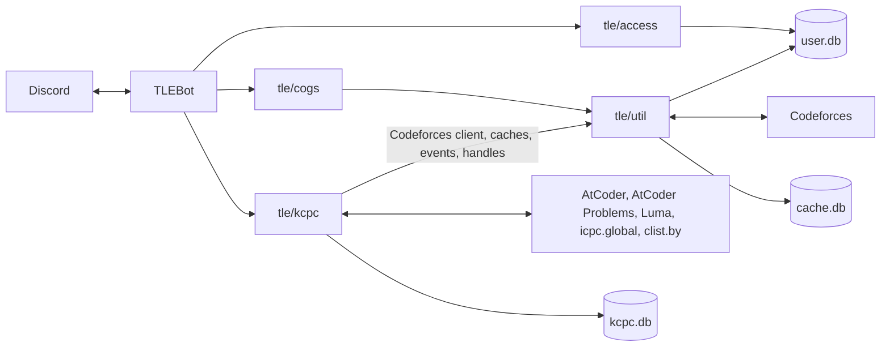
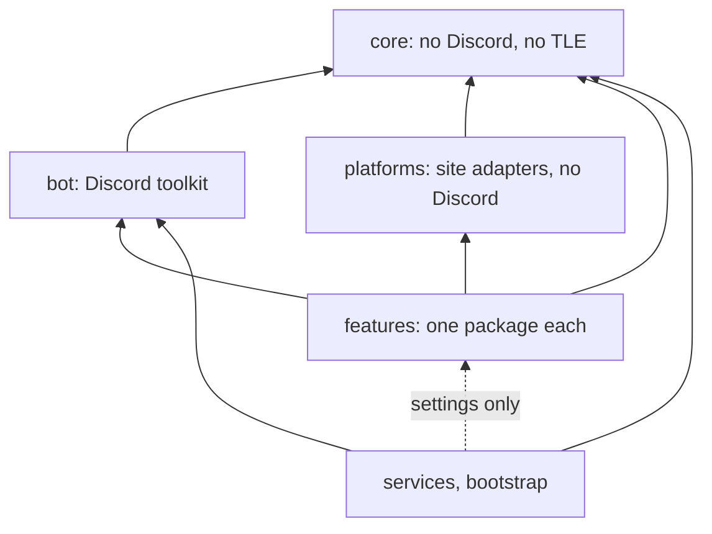
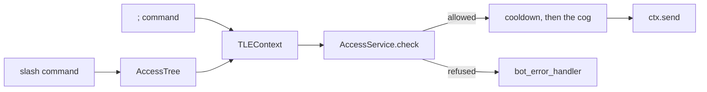
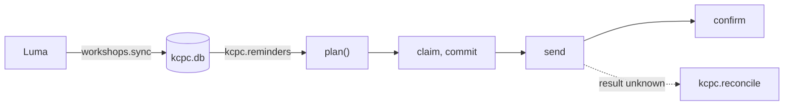

# Architecture

One process runs three parts: TLE, a Codeforces bot; KCPC, one club's features;
and an access layer that decides who may use each command, and where. All data
is in SQLite files.

| Section | Question |
| --- | --- |
| [1. Summary](#1-summary) | How is it built? |
| [2. Reasons](#2-reasons) | Why is it built so? |
| [3. Changing it](#3-changing-it) | How do I change it, and what can break? |
| [4. Open work](#4-open-work) | What can I pick up? |

[INSTALLATION.md](INSTALLATION.md) covers setup, and [README.md](README.md) the
features and settings.

## 1. Summary

### Parts



| Place | Holds |
| --- | --- |
| `tle/__main__.py` | `TLEBot`: start and stop |
| `tle/extensions.py` | which extensions load (`DISABLED_EXTENSIONS`) |
| `tle/config.py`, `tle/constants.py` | settings; new ones go in `config.Settings` |
| `tle/cogs` | TLE's commands |
| `tle/util` | Codeforces client, caches, TLE's databases, tasks, events, OAuth |
| `tle/access` | the rule table, the check of every command, `/access`, `/help` |
| `tle/kcpc` | the club's features, in layers |
| `tests/unit`, `tests/component`, `tests/integration` | tests of TLE and access |
| `tests/kcpc` | tests of KCPC; `component/booting.py` boots the real bot |

### Layers of KCPC

An arrow means "imports".



`bot` and `platforms` don't import each other, and neither do features. In a
feature, only `cog.py` and `views.py` import Discord. Each layer has its own list
of allowed TLE modules, and nothing in KCPC imports `tle.access`.
`tests/kcpc/unit/test_architecture.py` enforces all this.

### Start and stop

`TLEBot.setup_hook` runs before the bot connects. Its order is fixed by
`test_setup_hook_starts_things_in_order`, which covers all but the OAuth server:

1. the `tle.logging` extension, so that start-up problems reach the log channel
2. the databases, caches and events (`codeforces_common.initialize`)
3. the access settings, `/access` and `/help`
4. KCPC's services (`bootstrap.build_services`)
5. TLE's extensions, then KCPC's
6. the OAuth server, if configured
7. the bot's owners, the report of commands without a rule, and the pass that
   hides staff slash commands
8. the slash command sync

A TLE extension that fails to load stops the bot. A KCPC extension that fails is
logged and left out; if KCPC's services fail, all of KCPC is. Three things in KCPC
can still stop the bot: an error in the `tle.kcpc.core` modules that `config.py`
and `__main__.py` import, an invalid `KCPC_TIMEZONE`, and a slash command that
Discord refuses.

`TLEBot.close` stops KCPC, the OAuth server, `user.db`, `cache.db` and the
connection, in that order. `--nodb` replaces `user.db` with a stand-in, and turns
KCPC off.

### A command



`check` keeps its decision on the context. If a slash command must answer
privately, `TLEContext` makes every answer private.

### An automatic post

This is a workshop reminder. Contest reminders take the same path.



Reading a site and posting meet only in the database, so a site that is down
doesn't stop reminders of what is already known. The weekly problem, the algorithm
of the month and contest results plan their own posts, but publish the same way.

### Codeforces data

`ContestCache` sends `ContestListRefresh`, which wakes the caches of rating changes
and ranklists, and the timers of `;remind`. New rating changes send
`RatingChangesUpdate`, which updates rank roles and starts KCPC's results posts.

### Data

| File in `data/db` | Holds | Schema | Safe to delete |
| --- | --- | --- | --- |
| `user.db` | Codeforces handles, duels, gitgud, starboards, access settings | `create_tables` | no |
| `cache.db` | Codeforces data | `create_tables` | yes, then refill it |
| `kcpc.db` | KCPC's settings, contests, workshops, AtCoder links, the record of posts | numbered migrations, with a backup before each upgrade | no |

### Background work

| | TLE: `tle/util/tasks.py` | KCPC: `core/scheduler.py` |
| --- | --- | --- |
| Runs on | a delay or an event | slots in the club's time zone |
| State | in memory | in memory; `weekly.post` and `algo.post` record their last slot |
| After downtime | some tasks catch up from the databases | a persistent job runs its latest missed slot, if not too late |

## 2. Reasons

### Stated in the code, tests, commits, issues or README

| Decision | Reason | Consequence |
| --- | --- | --- |
| `aiosqlite` | Blocking database calls stopped the event loop | All database methods are async |
| KCPC can fail alone | A club feature must not take TLE down | TLE's cogs import KCPC only inside functions |
| One KCPC module reaches `user.db` | TLE attaches it to the bot, where import rules can't see it | `bot/codeforces_links.py` is the only bridge to Codeforces handles |
| Posts go out at most once: claim, commit, send, confirm | Members must not get the same ping twice (#1) | A crash can lose a post. Every automatic post uses `services.publisher`, outside transactions |
| `synchronous = FULL` in `kcpc.db` | A claim must be on disk before its post is sent | One disk sync for each commit |
| `plan()` uses only the time, the occurrences and the record of posts | A run can stop anywhere, or repeat, without a double post | Reminder logic is tested without Discord |
| An injected `Clock` | Tests drive time instead of waiting | KCPC code never calls `datetime.now` or `asyncio.sleep` |
| One access check and one rule table | Every command must be checked (#3) | Commands carry no role check of their own. A slash command that wraps no `;` command is refused, as the check can't see it |
| `rules`, `settings`, `table` and `policy` don't import Discord | Each decision can be tested on its own | `service.py` and `context.py` connect them to Discord |
| Who is decided before where | A refusal must not tell a member about a command they may not use | `;` gives no answer at all |
| The bot owner isn't an admin, nor the reverse | Owner commands affect every server | A club contest command needs both |
| The bot leaves an unlisted server only as it joins | A mistake in `ALLOWED_GUILD_IDS` must not remove it from the club's server | It ignores commands in unlisted servers it is already in |
| Calls to Codeforces are spaced, retried, and reported once per outage | Short failures are normal, and each used to be posted | Tasks log Codeforces errors at INFO; the client warns when they last |
| `contest.standings` is an anonymous GET | Codeforces refuses any other form for a regular contest | Only official contestants are listed; `ranklist/virtual.py` scores the rest |
| KCPC fetches no codeforces.com page | Its `robots.txt` and bot check forbid it | Solutions link to the contest page, unless an admin sets a link |
| AtCoder results come from profiles | Standings are off limits to bots | Results have no places |
| The rating monitor saves, sends the event, then refreshes | A slow refresh was cancelled, and the event with it | Keep this order (`359a06d`) |
| KCPC serves one club | Its servers share contests and a time zone | Commands that change club contests are the bot owner's |
| Compose stops the bot with SIGINT | Python as PID 1 ignores SIGTERM | `TLEBot.close` runs on stop |

### Inferred

No source states these reasons.

- **Features never import each other:** each works while another is off or broken.
  They share through registries in `core`, and copy some small helpers.
- **Access fails closed:** a missing rule or unreadable settings must not open
  anything. `/access` and `/help` keep working, so that an admin can repair it.
- **KCPC is a separate package and database:** fewer conflicts with upstream TLE,
  migrations and durability settings of its own.
- **Raw SQL:** small queries, with bound parameters.
- **TLE's own tasks and events:** they can wait for an event, as well as a delay.
- **KCPC's own scheduler:** TLE's tasks don't record slots or catch up on them.
- **Tokens to link accounts:** they need no OAuth, and AtCoder has no profile API.
- **Global slash sync:** one command list for all servers.

### Accepted limits

- One process: caches, locks and pending sign-ins are in memory.
- English only. Tests compare texts exactly.
- icpc.global gives only dates, so the bot owner sets the times of ICPC contests.
- Two AtCoder contests that end together can be confused in the results.

## 3. Changing it

### Recipes

**TLE command.** Write it in a cog, without a role check. Add its rule to `RULES` in
`tle/access/table.py`: without one, it is the bot owner's alone, in the staff channel.
Update `test_access_table.py`, `test_command_catalog.py` and, for a slash form,
`test_slash_menu.py`. A new cog also needs a `COG_CATEGORY`.

**KCPC feature.** `tle/kcpc/features/algo` is the model.

1. Create the package. Put SQL in `repo.py`, and Discord in `cog.py` and `views.py`.
2. Add it to `KCPC_EXTENSIONS`, after `kcpc.admin`.
3. For settings, register a `FeatureSpec` (`core/settings.py`). If it has a settings
   class, register it in `bootstrap._assemble`.
4. In `cog_load`, add jobs last, and undo earlier steps on an error: discord.py
   doesn't call `cog_unload` then.
5. Put `kcpc_admin_only()` on each admin command, and add the rules.
6. Update `test_extensions.py`, `test_boot.py`, `test_feature_texts.py` and the tests
   of a TLE command.

**Contest site.** On clist.by, add a `ClistSource` to `clist_sources`. Otherwise write
an adapter in `platforms`, and a source in `features/contests/sources.py`. Then add it
to `PLATFORMS`, `_PLATFORM_NAMES` and `_SYNC_INTERVALS`. Problems or results from a new
site also need a migration, as the tables allow only `codeforces` and `atcoder`.

**Migration of `kcpc.db`.** Add a module to `core/migrations`, with one `db.execute`
for each statement, and list it in `ALL_MIGRATIONS`. Never edit a released one.
Update `test_migrations.py`.

**Algorithm topic.** Add an `AlgoTopic` inside its level's group in `algo/catalog.py`.
Not first or last: `test_algo_cog.py` pins the first two and the last.

### Traps

- **Stored settings keep every field.** A new default, such as another contest
  platform, doesn't reach servers that have already changed that feature's settings.
- **Job names, delivery keys and topic slugs are stored.** Don't rename them.
- **A reminder revision means one start and one state.** If a source uses it again,
  the new post counts as already made.
- **Event waits are one-shot.** An event sent while its task is running is missed.
- **`tasks`, `codeforces_common` and `cache` import each other.** Import `tasks`
  lazily in `discord_common`.
- **A view must call `component_allowed`.** No test enforces it.
- **`allowed_mentions` blocks role and @everyone pings** unless a message allows them.

discord.py:

- A `;` twin declared inside a group with a slash fallback of the same name removes
  that fallback. Add the twin in `cog_load`.
- `can_run` decides for the context it gets, so it misjudges the other form of a
  command. Use `AccessService.decide` and `listed_slash_path`.
- `Context.send` posts publicly once an interaction has expired. `TLEContext` raises
  `PrivateAnswerExpired` instead.
- A removed slash form still looks attached. Only the tree shows that it is gone.
- A group's checks don't run for its subcommands.
- A cooldown set below the command decorator is shared by all copies of the command.
- A cooldown counts a mistyped command, unless it has `cooldown_after_parsing=True`.
- Archived threads leave the cache, so never store a thread's ID for later posts.
- An uncached thread has no parent, so a `;` command there is refused.
- An optional channel on `;` reads unknown text as no channel. Use a converter.
- `send_help` sends nothing without a help command. `TLEContext` replaces it.
- Setting `bot.tree.interaction_check` hides the check of `AccessTree`.

### Texts

`test_command_texts.py` and `test_feature_texts.py` check most rules. They don't check
these:

- Use plain technical English and British spelling, and write to "you".
- Write "Codeforces" and "virtual contest" in prose, not "cf" and "vc".
- `/help` joins the lines of a paragraph, keeps list items apart, and shows rows with
  ` | ` as a table.
- Discord shows a mention in a code span as plain text.

### Checks

CI runs these, with Python 3.10 to 3.12 for the tests. It also audits the
dependencies and builds the image.

```sh
pip install ".[test]" ruff==0.9.7 mypy==2.3.1
pytest
ruff check . && ruff format --check .
mypy tle
```

Tests that boot the bot skip without PyGObject (`gi`), so on Windows most likely only
CI runs them. Tests of live sites need `KCPC_NETWORK_TESTS=1`.

## 4. Open work

Nothing here has a date. Each item was open in the code when this was written.
`ROADMAP.md`, `AUDIT.md` and `TESTING_PLAN.md` are older, and list finished work as
open.

### Good first tasks

| Task | Start in | Note |
| --- | --- | --- |
| Add an algorithm topic | `features/algo/catalog.py` | See the recipe |
| Add a clist.by site | `features/contests/sources.py` | Needs a free clist.by key to try |
| Let admins set `reminder_minutes` | `features/contests/cog.py`, `features/workshops/cog.py` | The engine already uses the setting; copy `start-posts` |
| Expire old duel challenges at start | `tle/cogs/duel.py` | After a restart their buttons are dead, but they still block both members |
| Keep draw offers after a restart | `tle/cogs/duel.py` | A new table is enough |
| Make `;meta git` work in Docker | `tle/cogs/meta.py`, `Dockerfile` | The image has no git and no repository |
| Write module docstrings | `tle/cogs`, `tle/util` | A good way to learn the code |
| Set ruff's target to `py310` | `ruff.toml` | The project supports Python 3.10 |
| Add Dependabot and a lock file | `.github`, `pyproject.toml` | The lock file needs a choice of tool |
| Remove unused code | `constants.TEMP_DIR`, the `codeforces.com` host policy | Rename `_PLANNED_FEATURES` too: all of them exist |

### Larger tasks

| Task | Start in | Note |
| --- | --- | --- |
| Link more sites | `features/accounts/service.py` | A site needs a public profile field that bots may read |
| Edit a club contest, or undo `settime` | `features/contests/repo.py` | Its name and link are fixed, and only its time can change |
| Post AtCoder Heuristic results | `features/contests/results.py` | Needs a second rating and baseline |
| Give `;` commands slash forms | `tle/cogs/graphs.py`, `tle/cogs/duel.py` | Most plots take free-form arguments |
| Draw plots off the event loop | `tle/cogs/graphs.py` | matplotlib blocks it today |
| Split logic from Discord in TLE's cogs | `tle/cogs` | KCPC's features are the model |
| Remove the globals of `codeforces_common` | `tle/util` | The import cycle is the obstacle |
| Turn on the mypy codes that are off | `pyproject.toml` | One module at a time |
| Add a health check | `Dockerfile` | Needs a sign of life first; the only HTTP server is optional |
| Back up `user.db`, and keep `logs/` | `docker-compose.yaml` | Only `kcpc.db` is backed up, before upgrades |
| Let members delete their data | `tle/util/db`, `tle/kcpc/core` | `/unlink atcoder` removes only that link |
| Test against a real Discord server | `tests` | Needs a test server and token |

### Blocked, or needs the owner's decision

| Task | Waits for |
| --- | --- |
| Duels and gitgud per server | Migrations for `user.db`; a rule to split existing rows |
| One type for user IDs in `user.db` | Migrations for `user.db` |
| One reminder system and one results system | A choice: TLE's `;remind` and `;roleupdate publish` overlap with KCPC |
| Fewer ways to link Codeforces | A choice between `/link codeforces`, `/handle identify` and `;handle set` |
| Post times per server | A choice: slots and delivery keys use the club's time |
| ICPC start times | A source that has them |

### Not planned

- Support for many clubs, or for more than one process.
- Translation.
- Moving TLE's tasks to `discord.ext.tasks`.
- Renaming commands that start with an underscore: the rule table decides access.
- Optimising the presence task or the rating calculator without a profile.
